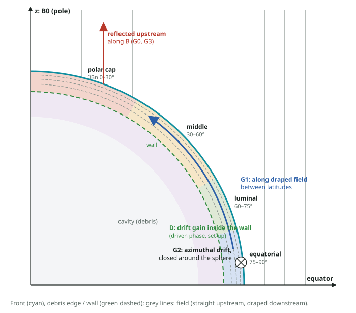
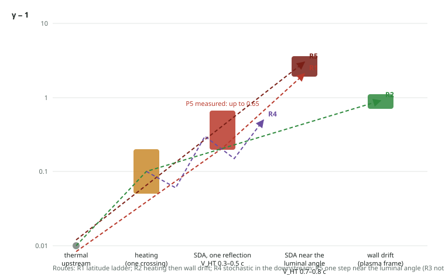

# Global plan: electron acceleration over a whole spherical shock

Written 2026-11-13 at the owner's request: the parts (reflection, wall drift, heating) are studied, but the
picture of the whole sphere is missing. This plan places every piece of work under one question. Campaign A
(`campaign-a.md`) is one building block of it.

## 1. The question

**Where on a spherical shock expanding into a uniform field are electrons injected and accelerated, by which
processes, and is the result over the whole sphere the area-sum of plane shocks at the local θ_Bn, or does the
sphere couple its latitudes?**

- Remnant models assume the first: an injection efficiency that depends on the local θ_Bn only
  (`volk2003variation`, `fulbright1990bipolar`, `petruk2009aspect`). Observations of SN 1006 are read either
  as bright polar caps (`rothenflug2004geometry`) or as an equatorial belt (`fulbright1990bipolar`), and the
  reading depends on that assumed dependence (`petruk2009aspect`, `west2016connection`).
- For protons, test particles at a spherical blast wave are accelerated near the equator and collect at the
  poles by moving along field lines (`giacalone2017acceleration`): the latitudes are coupled.
- For electrons at a curved shock, curvature lowers the gain of one reflection and focuses the reflected
  flux (`kraussvarban1991electron`, test particles in hybrid fields); 2-D full PIC exists at bow-shock
  parameters (`savoini2001twodimensional`, `savoini2010origin`). A 3-D self-consistent sphere for electrons was
  not found (`literature.md`). The key works are known by abstract only: novelty is not yet supported.

## 2. Hypotheses about the whole sphere

- **G0, local:** at every latitude the electrons behave as at a plane shock with the same θ_Bn, V_sh, M_A, β
  and age; the map of the sphere is the area-weighted sum.
- **G1, coupling along field lines:** electrons energised at one latitude reach another along the field
  (escape upstream and return; streaming along the field lines draped over the downstream shell) and gain
  again there: energetic electrons carry gains from two or more latitude bands, beyond the local maxima.
- **G2, closed drift:** where the shock is quasi-perpendicular the drift along the front is azimuthal and the
  path closes around the sphere, so the time an electron drifts along the motional field is set by the expansion
  and not by drifting out of a plane shock.
- **G3, focusing:** curvature concentrates the reflected electrons upstream of some latitudes.
- **D, the driver:** in the driven phase the magnetic wall at the debris edge energises electrons on its inner
  side (path a). It is a property of the driven phase and of the set-up, and is kept apart from G0–G3.

## 2b. How do electrons reach high energy? Hypotheses on the order of the steps

Owner (2026-11-13): hypotheses on the sequence of the energising mechanisms are needed; the aim is to know how
electrons reach high energy. The energy one step can give, with the numbers of P5 (γ − 1 of the upstream
thermal electrons ≈ 0.01):

| step | where | gain of one step (P5) |
|---|---|---|
| heating in one crossing | transition layer | γ' + 0.05–0.2 (plasma frame) |
| one SDA reflection, bound from rest γ_HT²(1 + V_HT²) | the front, by V_HT | 1.20 at V_HT 0.3 c; 1.67 at 0.5; 2.9 at 0.7; 4.6 at 0.8 |
| drift along E_φ in the gradient of the wall | inner side of the wall | γ' ≈ 1.7–2.1 (electrons born inside the shell) |
| repeated reflections at one latitude | polar cap | settle near γ ≈ 1.24 in P5 (no ladder) |

- **R1, latitude ladder:** pre-heated by reflection at the polar cap (small V_HT, frequent) → moved to a lower
  latitude → reflected there, where V_HT and the bound are larger and only pre-heated electrons are reflected →
  the largest gain near the luminal angle. *Signature:* successive reflections at increasing polar angle with
  increasing gain. On an upstream field line the next encounter lies closer to the pole, so R1 needs transport
  across the field or along the draped downstream field.
- **R2, heating then drift:** heated once at a quasi-perpendicular latitude → drift along the motional E_φ in
  the gradient of the downstream wall, on the closed azimuthal path. *Signature:* a small gain in the layer, then
  a large gain on the wall done by E_φ, with a long azimuthal path.
- **R3, repeated encounters with the front.** Three processes with their names and definitions in the
  literature, kept apart:
  - *R3a, repeated reflections (repeated SDA):* reflected, brought back by upstream waves or by the front
    catching up, reflected again; no scattering downstream, no crossing into the downstream and back. What P5
    shows at the polar cap. *Signature:* successive returns from the layer, each gain at about the SDA bound of
    its V_HT.
  - *R3b, stochastic shock drift acceleration (SSDA; `katou2019theory`, `matsumoto2017electron`,
    `amano2022theory`):* pitch-angle scattering keeps the electron inside the transition layer of a
    quasi-perpendicular shock, where the gradient drift along the motional field energises it continuously.
    *Signature:* a long stay in the layer, μ not conserved, many small gains done by E_φ.
  - *R3c, diffusive shock acceleration (DSA, first-order Fermi):* scattering on both sides; repeated crossings
    from upstream to downstream and back; each cycle gives Δp/p ≈ (4/3)(U₁ − U₂)/v, which falls with v until
    v ≈ c. It needs a diffusion length κ cos²θ / U_s longer than the shock thickness (`amano2022theory`).
    *Signature:* alternating crossings of the front in both directions, the gain per cycle against (4/3)ΔU/v.
  - The founding papers of DSA have no note yet (to be added by abstract).
- **R4, stochastic in the downstream:** after heating, gains and losses between downstream structures (wall,
  ramp, fluctuations) with a positive net (the owner's earlier picture of several heating sites). *Signature:*
  gains of both signs at alternating sites; the spread grows with the number of site changes.
- **R5, one SDA step:** an electron of the thermal tail is reflected once near the luminal angle and has its
  maximum from that step alone (no chain; the G0 picture). *Signature:* one reflection, γ_out near the bound,
  near the luminal angle.

**M6, the order of the steps (fixed now, before the histories of campaign A are read):** for the top 1 % of the
electrons born outside the shell by γ_max in each run, the ordered list of steps that carry their gain (block
work ≥ 0.05 in γ, with its site, polar band and dominant component, and the reflections of the entry table).
Each electron is assigned the pattern R1–R5 whose signature it meets (rules as above, R3 split into
R3a–R3c; an electron meeting none is "other"); the share of each pattern is reported per run and per temperature. A pattern is called the route to
high energy in a set when it holds for more than half of the top 1 % in both seeds.

## 3. Evidence so far (P5; notebook 2026-11-13)

| band (polar angle) | θ_Bn | what is seen |
|---|---|---|
| polar cap 0–30° | 0–30° | most reflections upstream (persistent returns 6 % of entries at 10–30°); γ up to 1.65; upstream γ ≥ 1.5 electrons sit here |
| middle 30–60° | 30–60° | reflections fall with V_HT (0.27 → 0.6 c), stop near 40–60°; one reflection gives about the SDA bound |
| luminal belt 60–75° | 60–75° | V_HT approaches c; almost no reflection |
| equatorial belt 75–90° | 75–90° | no de Hoffmann–Teller frame; electrons heated once, carried downstream |
| downstream shell, piston wall | – | heating; drift gain on the inner side of the wall (electrons born inside the shell) |

Not yet looked at: latitude histories (G1), azimuthal drift length (G2), the reflected flux against a plane
shock (G3), the energy budget per band, any plane-shock baseline (G0).

## 4. What is measured over the sphere (defined now, before campaign A's histories are read)

From the histories saved by `analyze.py campaign` (electrons with γ_max ≥ 1.25 and a 2 % sample; every 4th
sample; work by component per block) and the entry tables:

- **M1, injection map:** per 10° band of polar angle, per unit area of the front, the number of electrons that
  are (a) reflected (persistent definition of `campaign-a.md` Sect. 8) or (b) reach a drift-frame energy of
  γ' ≥ 1.25 while within d_i of the front.
- **M2, latitude history:** for each electron with γ_max ≥ 1.5 (lab, born outside the shell), its net energy
  gain split by the polar band in which each block of work was done; the share of electrons with ≥ 25 % of their
  gain in a second band.
- **M3, azimuthal drift:** the azimuth an energetic electron travels while gaining, against its gain.
- **M4, energy budget:** the work on electrons per band and per unit area, summed over all tracked electrons
  (the 2 % sample scaled), against the kinetic energy flux through the front in that band.
- **M5, focusing:** reflected flux per unit area against the entry flux per unit area by band.

## 5. The baseline for G0: plane oblique shocks

G0 needs plane electron–ion shocks at the local parameters of the sphere. The engine's examples have no such
case (the relativistic-shock example is a pair plasma with a perpendicular field). **Engine work on main:**
an example of a piston-driven plane shock in an electron–ion plasma with an oblique field (θ_Bn a parameter),
quasi-2-D, with the diagnostics of this topic; its PR and gates on main, then main into trunk and the topic.
Runs: θ_Bn = 15–85° every 10° at the A5 parameters (m_i/m_e 16, V_sh ≈ 0.27 c, β and M_A of each temperature).
G0's map is then the sum over bands of the plane rates at that band's θ_Bn and V_sh, times the band's area.

## 6. Order of the work

1. **Campaign A (running):** the local reflection law against V_HT and electron speed (building block of G0
   and of M1, M5) and the histories at seven conditions (M1–M4 on the sphere).
2. **Main PR (engine):** the plane oblique shock example (Sect. 5), and the option of no ambient plasma inside
   the debris shell (removes the set-up population of path a). Gates, merge, main into trunk and the topic.
3. **Plane runs** at the θ_Bn grid; G0's map.
4. **Global verdicts:** criteria for M1–M5 against G0 (map ratio per band; multi-band share against the plane
   runs, where it is zero by construction; drift length against the plane drift length) written and committed
   after step 3 and before the sphere histories are compared.
5. **Depending on 4:** a larger sphere (an engine option for a mirror plane at the equator: half the volume)
   for longer times and closed drifts; reruns without ambient plasma in the shell.
- **Literature, in parallel:** full texts of `giacalone2017acceleration`, `kraussvarban1991electron`,
  `holman1983solar`, `savoini2001twodimensional`; forward citations of Giacalone 2017 for electrons.

## 7. Possible results

- G0 holds: the local-θ_Bn assumption of remnant models is confirmed for electrons at the kinetic level, with the
  measured map (which band injects) as the result.
- G1 or G2 holds: the map and the maximum energy of a sphere differ from the sum of plane shocks, by a
  mechanism named and measured; remnant models that assume local injection miss it.
- Limits that stay: m_i/m_e = 16, a driven young shock, V_sh/c ≈ 0.27, a box of a few ion gyro-radii.
