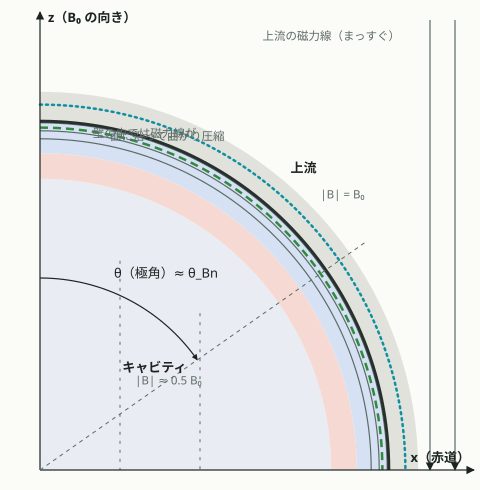
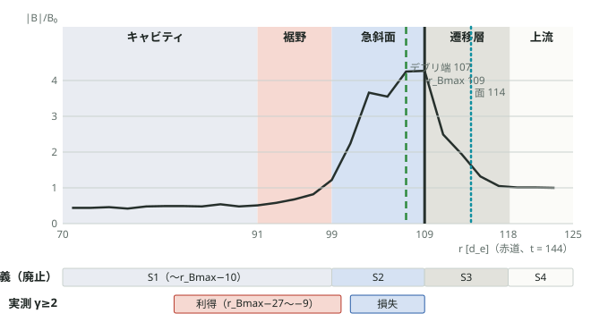
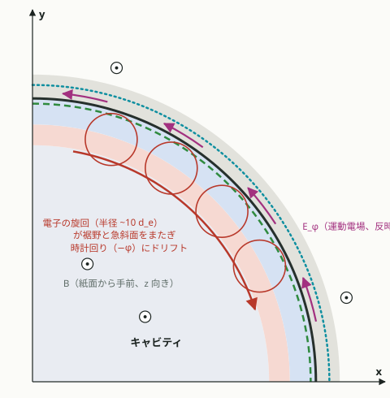
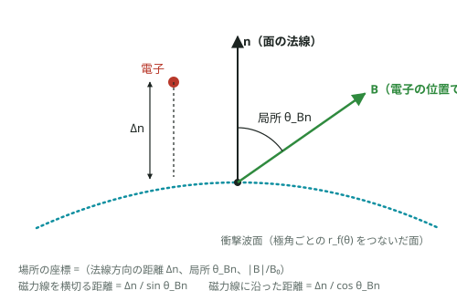

# Sites of the driven shock

The reference for every analysis of where electrons gain or lose energy in this topic, from 2026-11-13 on
(owner's instruction: commit the four figures and analyse on their basis). Code: `sites.py`
(`analyze.py sites`, `analyze.py sitegain`). Figures: `figures/`, drawn by `figures/site_schematic.py`.

**Status: defined after seeing the data of P5.** Every result on these sites is post hoc until a run that was
not looked at is analysed with them unchanged. The earlier sites S1–S4 (cut at r_Bmax − 10 d_e, notebook
entry "several heating sites") are withdrawn: their cut split one magnetic wall into a gaining and a losing
part.

## The structure

A dense debris shell expands into the magnetised ambient plasma and pushes the field out: a magnetic cavity
inside, a wall of compressed field at the debris edge, the shock front ahead of it. B₀ is along z, so on the
upstream side the polar angle θ is close to θ_Bn.

*Meridional plane (P5, t = 144, equator values; schematic).* The front r_f (ambient ion density 1.5 n₀), the
debris edge r_d (debris ion density 0.1 n₀) and r_Bmax (maximum of |B|) are measured on every polar-angle ray of
5°. Inside the wall the field lines bend along the surface and are compressed.

## The sites

Per ray (polar angle bin) and output, from the |B| / B₀ profile of the meridional slice (median in bins of
2 d_e, both hemispheres folded):

| site | radius | at t = 144, equator [d_e] |
|---|---|---|
| cavity | r < r₀ | < 91 |
| wall foot | r₀ ≤ r < r₁ | 91–99 |
| steep wall | r₁ ≤ r ≤ r_Bmax | 99–109 |
| transition layer | r_Bmax < r ≤ r_f + d_i | 109–118 |
| upstream | r > r_f + d_i | > 118 |

- r_Bmax: the maximum of the profile within 40 d_e inside r_f + d_i (it must reach B₀).
- r₁: from r_Bmax inwards, the innermost radius of the contiguous run with |B| ≥ B₀.
- r₀: from r₁ inwards, the innermost radius of the contiguous run with |B| > 1.1 B_cav, where B_cav is the
  median |B| between r₁ − 40 and r₁ − 20 d_e.
- A sample with any boundary missing (no front at that angle and time) has no site.

*Equatorial ray at t = 144: measured |B| / B₀ with the sites by the rule above.* The bar "old definition" is the
withdrawn S1–S4. The bar "measured γ ≥ 2" is where the 350 tracked electrons with γ_max ≥ 2 gained (r_Bmax − 27
to −9 d_e, pooled over the run) and lost (−8 to 0) energy: the gain reaches about 10 d_e into the cavity
beyond the foot, as the Larmor radius of a γ ≈ 3 electron in 0.5 B₀ is about 20 d_e.

## What was seen at the wall (P5)

*Equatorial plane, B out of the page.* The energetic electrons gyrate on loops of about 10 d_e across the foot
and the steep wall and drift in −φ, since |B| grows outwards. The motional field E_φ (= V_r B_z > 0) on the
wall then does positive work on them: the physics of shock drift acceleration, here at the wall on the debris
side. Notebook entries of 2026-11-13 hold the numbers.

## Coordinates of a sample

Besides its site, each sample of a tracked electron gets:

- Δn, its distance from the front along the local normal (radial in this approximation);
- the local θ_Bn, between the field B at the electron and the normal of the surface r_f(θ) at its polar angle
  (`sites.local_tbn`; both hemispheres folded to 0–90°);
- |B| / B₀ at the electron.

Across the field the distance to the front is Δn / sin θ_Bn, along it Δn / cos θ_Bn. Near the equator the
field lies along the surface and Δn is the cross-field distance; at middle latitudes it is not.
